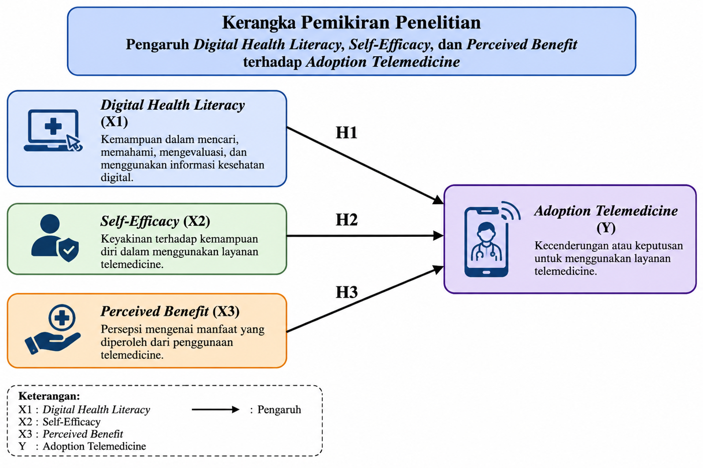

# Analisis Faktor Adopsi Telemedicine dengan Regresi Linear Berganda

Analisis pengaruh **Digital Health Literacy**, **Self-Efficacy**, dan **Perceived Benefit** terhadap **Adoption Telemedicine** menggunakan regresi linear berganda di **Jamovi**, disusun dalam format artikel jurnal.

Penulis: **Zidnia Ilma Arifa** dan Syahiduz Zaman, M.Kom.
Program Studi Teknik Informatika, UIN Maulana Malik Ibrahim Malang (2026).

> **Catatan:** analisis ini memakai **data simulasi** sebanyak 100 responden sebagai latihan prosedur analisis. Hasilnya tidak mewakili populasi nyata.

## Isi Repositori

| File | Isi |
|---|---|
| `artikel.pdf` | Artikel lengkap: pendahuluan, metode, hasil, pembahasan, dan daftar pustaka |
| `kerangka-pemikiran.png` | Gambar kerangka pemikiran penelitian |
| `instrumen-kuesioner.md` | Kuesioner lengkap: 20 pernyataan skala Likert 1–5 beserta indikatornya |
| `template-data.csv` | Format tabel data responden (kolom DHL1–AT5) untuk diisi |
| `analisis_regresi.py` | Skrip Python untuk uji validitas, reliabilitas, regresi, uji F, dan uji asumsi klasik |

## Pertanyaan Penelitian

Apakah kemampuan literasi kesehatan digital, keyakinan diri, dan manfaat yang dirasakan berhubungan dengan niat seseorang menggunakan telemedicine?

| Hipotesis | Pernyataan |
|---|---|
| H1 | Digital Health Literacy berpengaruh positif terhadap Adoption Telemedicine |
| H2 | Self-Efficacy berpengaruh positif terhadap Adoption Telemedicine |
| H3 | Perceived Benefit berpengaruh positif terhadap Adoption Telemedicine |
| H4 | Ketiga variabel secara simultan berhubungan dengan Adoption Telemedicine |



## Metode

| Aspek | Keterangan |
|---|---|
| Pendekatan | Kuantitatif, regresi linear berganda |
| Data | Data simulasi, 100 responden |
| Instrumen | 20 pernyataan skala Likert 1–5 (5 pernyataan per variabel), lihat [`instrumen-kuesioner.md`](instrumen-kuesioner.md) |
| Variabel | X1 Digital Health Literacy, X2 Self-Efficacy, X3 Perceived Benefit, Y Adoption Telemedicine |
| Alat analisis | Jamovi |
| Model | Y = a + b1X1 + b2X2 + b3X3 + e |

## Hasil

**Ringkasan model**

| Ukuran | Nilai |
|---|---|
| N | 100 |
| R | 0,653 |
| R² | 0,427 |
| Adjusted R²* | 0,409 |
| Uji F* | F(3, 96) = 23,85; p < 0,001 |

Model menjelaskan **42,7%** variasi skor Adoption Telemedicine. Secara simultan, ketiga variabel berpengaruh signifikan terhadap adopsi (H4 diterima).

\* Adjusted R² dan uji F tidak tercantum di output Jamovi yang dilaporkan. Keduanya dihitung dari R² = 0,427, N = 100, dan 3 prediktor dengan rumus F = (R²/k) / ((1 − R²)/(N − k − 1)).

**Koefisien regresi**

| Prediktor | Estimate (B) | SE | t | p | Keterangan |
|---|---|---|---|---|---|
| Intercept | 0,274 | 0,3409 | 0,805 | 0,423 | Tidak signifikan |
| Digital Health Literacy (X1) | 0,442 | 0,0822 | 5,375 | < 0,001 | Positif, signifikan |
| Self-Efficacy (X2) | 0,241 | 0,0835 | 2,886 | 0,005 | Positif, signifikan |
| Perceived Benefit (X3) | 0,227 | 0,0825 | 2,751 | 0,007 | Positif, signifikan |

**Persamaan regresi**

```
Y = 0,274 + 0,442 X1 + 0,241 X2 + 0,227 X3
```

## Interpretasi

- **Digital Health Literacy** memiliki koefisien terbesar: setiap kenaikan satu unit skor literasi kesehatan digital berkaitan dengan kenaikan 0,442 unit prediksi skor adopsi, dengan variabel lain dianggap tetap.
- **Self-Efficacy** dan **Perceived Benefit** juga berkoefisien positif dan signifikan (p < 0,05).
- Bagi penyedia layanan telemedicine, hasil ini mengarah ke tiga area evaluasi: edukasi penggunaan, antarmuka yang mudah dipahami, dan penyampaian manfaat layanan.

## Menjalankan Analisis Lengkap

Skrip `analisis_regresi.py` melengkapi output Jamovi dengan uji-uji yang belum dilaporkan di artikel:

| Tahap | Uji | Kriteria |
|---|---|---|
| Validitas item | Korelasi item-total terkoreksi | r hitung > r tabel (α = 0,05) |
| Reliabilitas | Cronbach's alpha | α ≥ 0,70 |
| Regresi | Koefisien, uji t, R², adjusted R², uji F | p < 0,05 |
| Multikolinearitas | VIF dan tolerance | VIF < 10, tolerance > 0,10 |
| Normalitas residual | Shapiro-Wilk | p > 0,05 |
| Homoskedastisitas | Breusch-Pagan | p > 0,05 |

Cara menjalankan:

1. Isi `template-data.csv` dengan jawaban responden (satu baris per responden, skor 1–5).
2. Jalankan:

```bash
pip install pandas scipy statsmodels
python analisis_regresi.py template-data.csv
```

Skor setiap variabel dihitung dari rata-rata kelima pernyataannya, sama seperti analisis di Jamovi.

## Keterbatasan dan Pengembangan

- Data bersifat simulasi, sehingga koefisien dan signifikansi belum mewakili responden nyata.
- Hasil uji validitas, reliabilitas, dan asumsi klasik belum dilaporkan di artikel. Skrip `analisis_regresi.py` disiapkan untuk menjalankannya.
- Penelitian lanjutan perlu memakai data responden sebenarnya beserta teknik sampling yang jelas.

## Teknologi

`Jamovi` · `Python` · `pandas` · `statsmodels` · `Regresi Linear Berganda` · `Statistik Inferensial` · `Skala Likert`

---

Dibuat oleh **Zidnia Ilma Arifa**, Teknik Informatika UIN Maulana Malik Ibrahim Malang.
